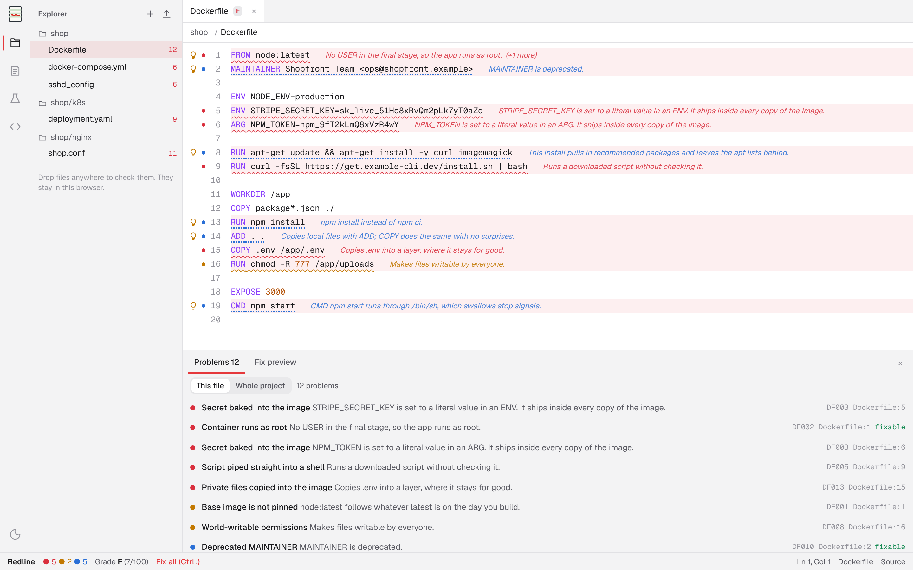
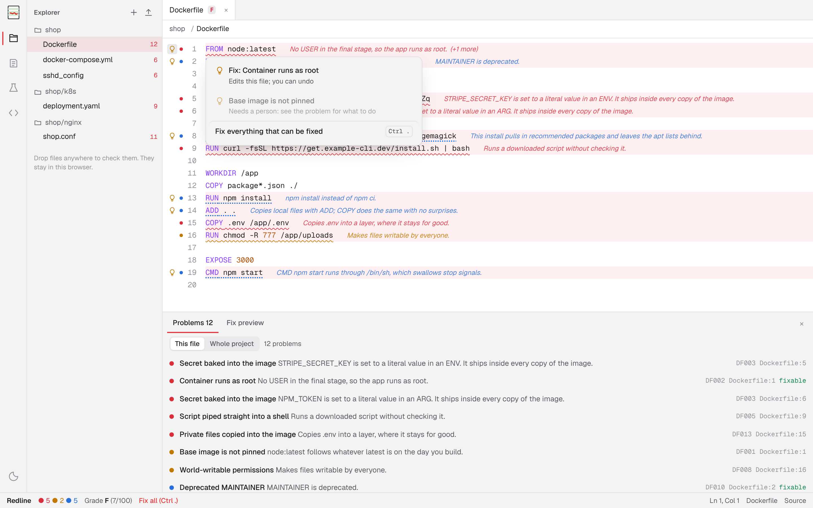
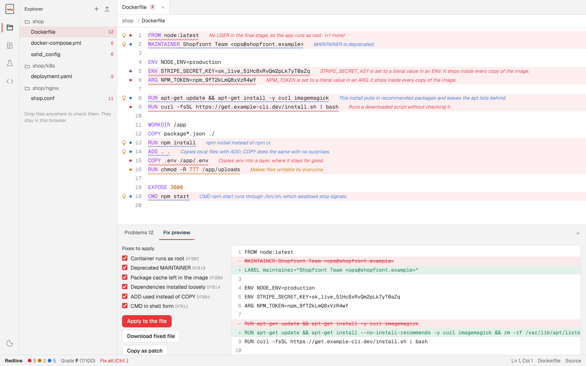
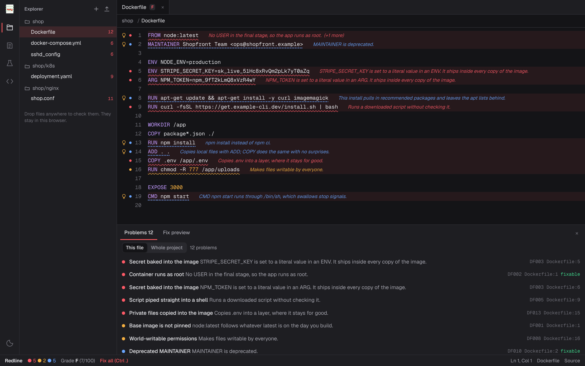
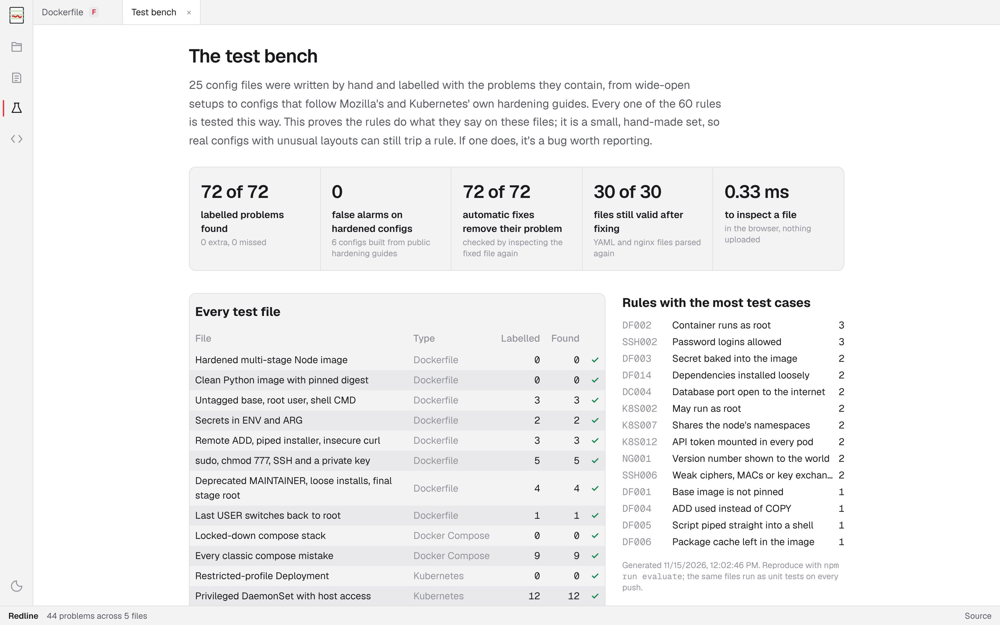
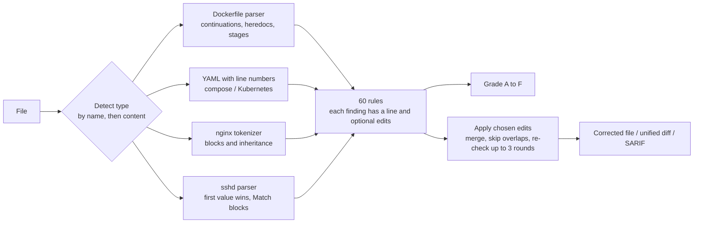

# Redline · A code editor that finds security mistakes in config files


Redline reads the config files that decide how secure a server is (**Dockerfiles, Docker Compose, Kubernetes manifests, nginx and sshd_config**) in an editor that works like VS Code. Mistakes get a wavy red underline as you type, with a short note at the end of the line, and each problem has a plain-English explanation: what is wrong on that line, why it matters, and how to fix it. For 37 of the 60 rules Redline writes the fix too, and a lightbulb next to the line applies it, so you get a corrected file or a patch you can apply with `git apply`.

It runs in the browser (nothing is uploaded), on the command line, as a GitHub Action that puts findings on pull requests, and as an API.



## Why

Most breaches of small companies don't need clever exploits. They need a database port left open, a container running as root, a `.git` folder served by nginx, or a password written in a compose file. These mistakes live in config files that few people review line by line. Redline is that review: it explains each problem in words a busy developer understands and writes the fix, so the fix actually happens.

Some of the checks catch traps that experienced people still fall into:

- **sshd uses the first value it reads.** "Hardening" lines added at the bottom of `sshd_config` do nothing if the same setting appears earlier, or in an `Include`d file like Ubuntu's `50-cloud-init.conf`. Redline marks the line that really wins.
- **`PasswordAuthentication no` isn't enough** with `UsePAM yes`: keyboard-interactive login still asks for passwords.
- **nginx `alias` off-by-slash:** `location /static` with `alias /var/www/static/;` lets `/static../` read the folder above.
- **nginx `add_header` inheritance:** one `add_header` in a location silently drops every security header set on the server.
- **Docker bypasses ufw:** `"5432:5432"` in compose opens the database to the internet even with a firewall on. Redline rewrites it to `127.0.0.1:5432:5432`.



## Fixing

Three ways, all with undo:

- Click the **lightbulb** next to a line to fix that problem (Ctrl . fixes everything that can be fixed).
- Open **Fix preview** in the bottom panel, untick the fixes you don't want, and see the change as a diff: green lines are written in, struck lines are taken out. Apply it, download the fixed file, or copy it as a patch.
- Or just edit the file: it is checked again on every key press.

The Problems panel lists everything in the file or the whole project; click one to jump to its line and read why it matters. Your files and edits stay in your browser. Fixes are written as small line edits, so your comments and layout stay as they were, and several fixes to the same Kubernetes container are merged into one `securityContext` block.





## Results

From `npm run evaluate` (the same files run as unit tests on every push):

| | |
| --- | --- |
| Labelled problems found | **72 of 72**, with no extra findings |
| False alarms on hardened configs | **0** across 6 configs built from Mozilla's nginx and OpenSSH guides and the Kubernetes "restricted" profile |
| Automatic fixes that remove their problem | **72 of 72**, checked by inspecting the fixed file again |
| Files still valid after fixing | **30 of 30** (YAML and nginx parsed again) |
| Time per file | **about 0.3 ms** |

**What this does and doesn't prove.** The 25 test files were written by hand and labelled with the problems they contain. Every rule is covered, but it is a small set: real configs with unusual layouts can still trip a rule or slip past one. The rules are pattern-based and don't know your context (a monitoring agent may really need host access), which is why each automatic fix can be unticked.



## How it works



- **Parsers that keep line numbers.** Each file type has its own parser, so findings point at the exact line. nginx is parsed into a tree so rules can follow how headers are inherited; sshd is parsed the way sshd reads it (first value wins, `Match` blocks apply only to some users).
- **Fixes are line edits, not reformatting.** A fix replaces or inserts lines at the right indentation. Edits that create the same block are merged; an edit that would overwrite a line another fix already changed is skipped. After applying, the file is inspected again, up to three rounds, because one fix can reveal another.
- **Grades.** Every finding costs points by severity (critical 30, high 12, medium 5, low 1). Any critical caps the grade at D, because one is enough to lose the machine.
- **SARIF 2.1.0** output with `security-severity` scores, so GitHub code scanning shows each finding on its line in the pull request.

## Run it

Requires Node 22.13+.

```bash
npm install
npm run dev          # web on :5173, API on :8080
npm test             # 70 unit and API tests
npm run test:e2e     # browser tests (Playwright)
npm run evaluate     # rebuild the test bench report
```

### Command line

`action/redline.cjs` is a single file with no dependencies (Node 20+):

```bash
node action/redline.cjs .                        # check a whole repository
node action/redline.cjs infra/ --fail-on critical
node action/redline.cjs Dockerfile --diff        # show fixes as a patch
node action/redline.cjs Dockerfile k8s/ --fix    # apply them in place
node action/redline.cjs . --format sarif --output redline.sarif
```

Exit code 1 when anything at or above `--fail-on` (default `high`) is found, 2 on a usage error.

### GitHub Action

```yaml
permissions:
  contents: read
  security-events: write
jobs:
  redline:
    runs-on: ubuntu-latest
    steps:
      - uses: actions/checkout@v5
      - uses: Vishwanathanirv/config-auditor@main
        with:
          fail-on: high
      - uses: github/codeql-action/upload-sarif@v3
        if: always()
        with:
          sarif_file: redline.sarif
```

This repository's own CI runs Redline on its own Dockerfile.

### API and Docker

```bash
docker build -t redline .
docker run -p 8080:8080 redline
```

| Endpoint | What it does |
| --- | --- |
| `POST /api/audit` | `{ "files": [{ "name", "text", "kind?" }], "format?": "json" \| "sarif" }` |
| `POST /api/fix` | `{ "name", "text", "rules?": ["DF002"] }` returns the corrected text, a patch, and before/after reports |
| `GET /api/rules` | Every rule with its explanation, fix and references |
| `GET /api/health` | Health check |

Nothing sent to the API is stored.

### Live demo on Vercel

Import the repository into Vercel. `vercel.json` builds the static site, which runs every check in the browser. No keys are needed.

## Limits

- One file at a time: Redline doesn't follow `Include` in nginx or sshd, and doesn't connect a compose file to the Dockerfile it builds.
- Kubernetes checks read plain manifests. Helm templates need `helm template` first; Kustomize needs `kustomize build`.
- Some problems need a person: Redline won't guess which version to pin or how much memory a pod needs, so those findings come without a fix.
- Fixes that change behaviour (a non-root user, a read-only filesystem) should be tested before shipping.

## Tech stack

TypeScript · yaml · Fastify 5 · zod · React 19 · Vite 6 · Tailwind CSS 4 · Vitest · Playwright · esbuild · Docker · GitHub Actions

## Licence

MIT
